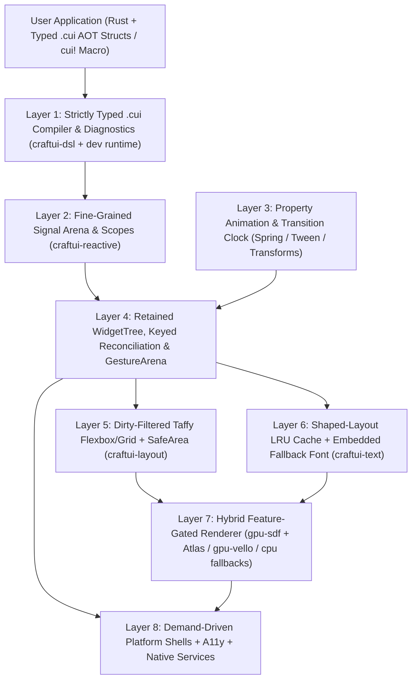

# CraftUI — System Architecture & Engineering Design (`ARCHITECTURE.md`)

## 1. Real-World UI Framework Principles Used by CraftUI

Production frameworks like **Slint**, **Zed GPUI**, and **Flutter** avoid naive re-render bottlenecks through five strict architectural invariants:

1. **Zero Redundant Per-Frame Shaping & Layout Sync:** Static text is shaped once and cached; font glyphs are rasterized into a GPU **Glyph Texture Atlas**; layout style updates propagate **only for dirty nodes**.
2. **Instanced SDF GPU Fast-Path Instead of Pure Vector Tessellation:** Over 90% of application UI consists of rounded boxes, gradients, borders, drop/inset shadows, images, and text. An **Instanced SDF Quad + Glyph Atlas pipeline** renders thousands of UI primitives in minimal draw calls and works cleanly even on **WebGL2 / OpenGL ES / Safari**, reserving heavy compute vector rasterization (`vello`) for arbitrary Bézier paths/Canvas via opt-in feature flags.
3. **Compile-Time Property Safety & Animation Integration:** The DSL compiler enforces strict per-widget schemas and scopes (emitting hard compile errors on typos), compiles reactive expressions for *all* layout/transform/style properties, attaches `Spring`/`Tween` interpolators directly to animated visual properties, and compiles out interpreter crates in release builds.
4. **Demand-Driven VSync Scheduling (0% Idle Power):** Neither desktop nor mobile nor web spins an idle render loop. Blinking carets use a 530ms UI timer; `requestAnimationFrame` / `poll_events` / `CADisplayLink` only submit GPU frames when `dirty || animating`.
5. **Clean Feature-Gated Crates:** Applications opt into only what they deploy (`gpu-sdf`, `gpu-vello`, `cpu-vello`, `cpu-tiny-skia`, `hot-reload`, `dsl`).

---

## 2. Eight-Layer Production Architecture



---

## 3. Cargo Workspace & Feature Architecture

```text
craftui/
├── Cargo.toml                         # Workspace root & shared lints/profiles
├── deny.toml                          # Strict permissive license gatekeeper
├── ROADMAP.md                         # Verified issue register & 4-phase production roadmap
├── crates/
│   ├── craftui-core/                  # Geometry, Transform2D, BlendMode, Color, Rich BoxShadow, Events, Services
│   ├── craftui-reactive/              # SlotMap Signal/Computed/Effect arena, Scope disposal, Timers, UiDispatcher
│   ├── craftui-layout/                # Dirty-tracked Taffy bridge, SafeArea insets, RTL mirroring
│   ├── craftui-text/                  # Parley + Fontique + LRU ShapedLayoutCache + 65KB Vera fallback + TextEditorState
│   ├── craftui-render/                # PaintScene + Feature-gated Backends: gpu-sdf (Atlas+SDF+Blur), gpu-vello, cpu-vello, cpu-tiny-skia
│   ├── craftui-a11y/                  # Incremental AccessKit TreeUpdate generator & action routing
│   ├── craftui-widgets/               # Retained WidgetTree, AnimatedProperty, Composable Widgets, Router, Toast, Inspector
│   ├── craftui-dsl/                   # Lossless rowan CST, per-widget typed validator, multi-file resolver, AOT Rust codegen
│   ├── craftui-runtime/               # Feature-gated state-preserving dev hot-reload interpreter
│   ├── craftui-macros/                # cui! inline proc-macro & #[component] macro
│   ├── craftui-platform-desktop/      # Demand-driven winit + AccessKit + non-blocking native clipboard/dialogs
│   ├── craftui-platform-android/      # Demand-driven GameActivity + Vulkan/GLES + IME/key/Kotlin templates
│   ├── craftui-platform-ios/          # CADisplayLink dirty-gated UIKit/Metal + C-ABI + Swift templates
│   ├── craftui-platform-web/          # On-demand WebGPU/WebGL2/2D WASM + DOM ARIA mirror + Web APIs
│   └── craftui/                       # Unified facade (feature-gating dsl, hot-reload, renderer backends, platforms)
├── tools/
│   ├── craftui-cli/                   # `new`, `dev`, `preview`, `check`, `render`, `doctor`, `build` (real bundlers)
│   └── craftui-lsp/                   # Context-aware .cui LSP (schema completion, goto-def, diagnostics, color picker)
└── examples/                          # counter, showcase, todo_crud, settings_form, canvas_paint
```

### Feature Flags (`craftui` & `craftui-render`)

| Crate | Feature Flag | Purpose |
| :--- | :--- | :--- |
| `craftui-render` | `gpu-sdf` | Lightweight batched WGSL Instanced SDF + Glyph Atlas + Kawase Blur pipeline (no compute shaders required) |
| `craftui-render` | `gpu-vello` | Full `vello` GPU compute vector rasterizer for complex paths/SVGs/Canvas |
| `craftui-render` | `cpu-vello` | Deterministic `vello_cpu` software fallback & headless snapshot renderer |
| `craftui-render` | `cpu-tiny-skia` | Minimal pure-CPU `tiny-skia` fallback |
| `craftui` | `dsl` / `hot-reload` | Optional parser & live hot-reload interpreter — **excluded automatically in lightweight release builds** |
| `craftui-text` | `embedded-fallback-font` | Embeds 65 KB `Vera.ttf` so Web/headless Linux never fail with blank text |

---

## 4. Core Frame & Update Pipelines

### 4.1 Demand-Driven Dirty Propagation Pipeline

```mermaid
sequenceDiagram
    participant Loop as Platform Event Loop (Wait / rAF / Poll)
    participant Sig as Signal Arena
    participant Tree as Retained WidgetTree
    participant Layout as Dirty Taffy Engine
    participant Text as ShapedLayoutCache + GlyphAtlas
    participant GPU as SDF+Atlas / Vello Surface

    Note over Loop: 0% CPU/GPU when idle (caret timer = 530ms)
    Loop->>Sig: Event / Timer / Background UiDispatcher
    Sig->>Tree: Mark affected NodeIds (LAYOUT | PAINT | TEXT | A11Y)
    Tree->>Tree: Advance active Spring/Tween timelines
    alt Needs Layout (DIRTY_LAYOUT)
        Tree->>Layout: Sync ONLY modified node styles -> taffy.compute_layout()
    end
    alt Needs Paint (DIRTY_PAINT || animating)
        Tree->>GPU: Record PaintScene (transforms, SDF shadows, blur, cached text)
        GPU->>Text: Lookup cached glyphs / shape dirty strings only
        GPU->>Loop: Present frame & clear dirty flags
    end
    alt A11y Active && DIRTY_A11Y
        Tree->>Loop: Emit incremental AccessKit update for changed nodes only
    end
```

### 4.2 Hybrid Rendering Pipeline (`gpu-sdf` Fast-Path + `vello` Vector Path)

* **UI Primitives (`gpu-sdf`):** Rounded rectangles (per-corner radii), borders, gradients, analytical SDF drop shadows, inset shadows, and glyph quads are packed into GPU instance buffers (`#[repr(C)]` `bytemuck::Pod`) and drawn with instanced WGSL shaders.
* **Backdrop Blur (Frosted Glass):** Multi-pass downsampled Kawase blur over the backdrop region before compositing tinted rounded overlays (`Modal`, `BottomSheet`, glass cards).
* **Vector & Canvas Fallback:** `FillPath` / `StrokePath` / complex SVGs rasterize cleanly either via `vello` (when `gpu-vello` is enabled) or cached texture upload from CPU path rasterizer on ultra-lightweight WebGL2/mobile targets.

### 4.3 Dual Compilation Model (Dev Hot-Reload vs Release AOT)

* **Dev Mode:** `HotReloadSession` watches `.cui` modules and diffs component structure while **preserving live `DynamicStore` signals, focus, and scroll offsets**.
* **Release Mode:** `build.rs` validates `.cui` strictly with `Severity::Error` diagnostics, emits zero-overhead typed Rust structs with reactive property bindings & compiled animation controllers, and omits `craftui-runtime` from the final linked binary.
