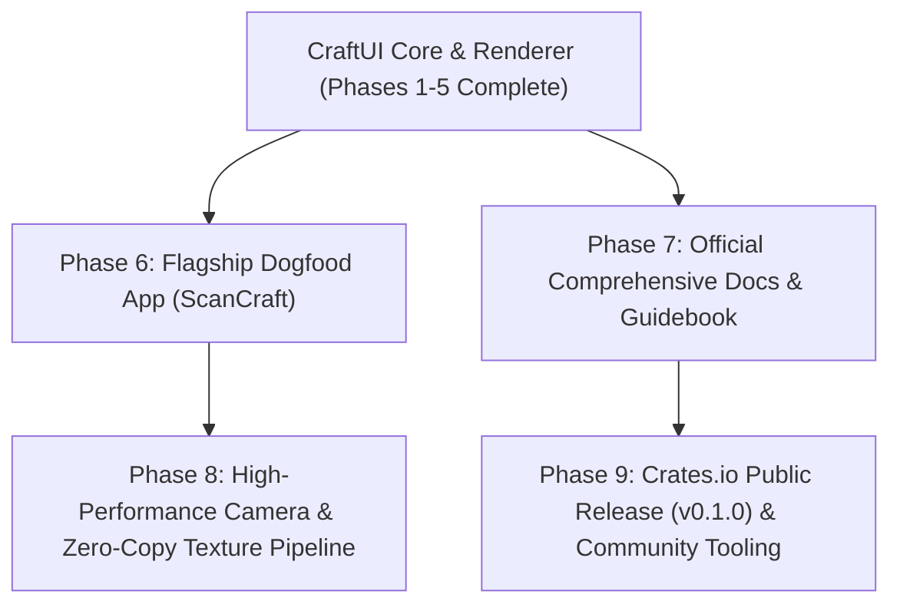

# CraftUI — Strategic Directions & Platform Matrix

> **Author Note for Developers & Contributors:**  
> Primary active development targets are **Linux Desktop** (Wayland/X11) and **Android** (physical devices + emulators via Android NDK/ADB on Linux).  
> **macOS, iOS, and Windows are NOT required** to build, test, run, and ship CraftUI applications. All tooling (`craftui-cli`, `craftui-lsp`, `wgpu`, shaders, assets, tests) is 100% self-contained on Linux and Android.

---

## 1. Executive Platform Focus

| Platform | Tier | Primary Dev Host | Tooling & Runtime Stack |
|---|---|---|---|
| **Linux Desktop** | **Tier 1 (Primary)** | Linux | Winit + WGPU (Vulkan / OpenGL), native Wayland/X11, in-process clipboard & file dialogs, 100% local testing. |
| **Android** | **Tier 1 (Primary)** | Linux | Android NDK 28+, `GameActivity`, `craftui-cli run --platform android`, direct ADB install & APK packaging, runtime permissions, edge-to-edge `SafeArea`. |
| **Web (WASM)** | **Tier 1** | Linux | `wasm32-unknown-unknown`, WebGPU / WebGL2, embedded HTTP WASM server (`craftui run --platform web`), zero-dep bundle. |
| **Windows** | Tier 2 | Linux (via Wine for validation) / Windows CI | WGPU (DX12 / Vulkan), Win32 clipboard & file dialogs. |
| **macOS & iOS** | Tier 3 (CI-Gated) | macOS CI runner only | Metal / UIKit / AppKit bridges via pure C-ABI templates emitted on Linux host without macOS dependency. |

---

## 2. Strategic Roadmap Directions

### Direction 1 (Phase 6): Flagship Real-World Dogfood App — "ScanCraft"
* **Target Objective:** Build a real, high-utility, beautiful mobile/desktop document scanner and media organizer in `examples/scancraft/`.
* **Core Capabilities Tested:**
  1. **Camera & Photo Ingestion:** Dynamic capture simulation and real device photo selection with `Permission::Camera` & `Permission::Photos`.
  2. **Real-time Image Filtering & Canvas:** High-performance 2D canvas manipulation: interactive crop rectangle, 90° rotation, brightness, contrast, grayscale, and document binarization/threshold filters.
  3. **Document Management:** Sortable and searchable document table using `DataTable` and `VirtualList`, with status badges, multi-selection, and deletion.
  4. **Native Mobile Touch & Feel:** Edge-to-edge `SafeArea` layout, native `Vibrate` haptics on snap, native system share sheet export, and instant dark/light theme switching.
  5. **Battery & Device Telemetry:** Status bar indicators showing real-time device power and storage space.

### Direction 2 (Phase 7): Official Comprehensive Documentation & Guidebook
* **Target Objective:** Full mdBook-compatible documentation in `docs/` covering everything needed to go from zero to building complex applications on Linux and Android.
* **Sections:**
  - **Quickstart & Installation:** Step-by-step setup on Linux (Rust, NDK, ADB, VS Code).
  - **`.cui` DSL Deep Dive:** Syntax, reactive state `{signal}`, two-way bindings `<=>`, conditionals, loops, transitions, and glassmorphism.
  - **Complete 25+ Widget Catalog:** Visual properties, code snippets, and accessibility semantics for every widget.
  - **Linux & Android Production Guides:** Manifest configuration (`craftui.toml`), 35 native permissions, APK generation, and debugging with `craftui doctor`.

### Direction 3 (Phase 8): Zero-Copy Hardware Texture Pipeline (Android & Linux)
* **Target Objective:** Directly stream camera frames and video surfaces to GPU textures without CPU RGBA copies.
* **Architecture:**
  - **Android:** Direct `AHardwareBuffer` / `SurfaceTexture` binding to `wgpu::Texture` via Vulkan external memory extensions.
  - **Linux:** DMA-BUF / V4L2 zero-copy texture import for camera feeds on desktop.

### Direction 4 (Phase 9): Crates.io Release & Packaging Automation
* **Target Objective:** Public `v0.1.0` release on Crates.io and VS Code Marketplace.
* **Deliverables:**
  - Complete crate metadata, READMEs, and license audits for all 15 crates.
  - `cargo package --dry-run` zero-warning verification.
  - Official VS Code extension `.vsix` publishing script.
  - One-click GitHub Releases with precompiled `craftui-cli` binaries for Linux x86_64 and aarch64.

---

## 3. Live Physical Device Validation (Realme Android 16)

* **Physical Device:** Realme `RMX5003` (Model `RMX5003IN`), Android 16 (`arm64-v8a`), 1080x2400.
* **Status:** Verified working live with full GPU rendering, dynamic `SafeArea` top cutout and bottom navigation insets, and responsive multi-touch.
* **Apps Deployed & Verified:**
  1. `dev.craftui.craftui_app` (`libcraftui_platform_android.so`): Native title, subtitle, and interactive button.
  2. `dev.craftui.craftui_example_scancraft` (`libcraftui_example_scancraft.so`): Flagship ScanCraft document scanner running all 4 tabs (Camera Viewfinder, Filter Studio with Canvas, Document Library with sortable DataTable, and Export & Info).
* **Screenshots & Artifacts:**
  - `scancraft_android_safe_full.png`: Edge-to-edge camera viewfinder with punch-hole cutout padding.
  - `scancraft_tab_tap.png`: Filter and enhancement studio with sliders and rotation.
  - `scancraft_library.png`: Document management DataTable with selection and deletion.
  - `scancraft_export.png`: System export format picker and share sheet trigger.
