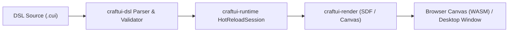

# Craftpad: Web Studio & Playground

**Craftpad** is the official interactive web playground and desktop studio for CraftUI. It allows developers to author, experiment with, and preview `.cui` declarative components inside any modern web browser or as a native desktop application.

---

## 1. Key Capabilities

- **Zero-Install Prototyping**: Test CraftUI directly in the browser via WebAssembly (`wasm32-unknown-unknown`) without installing Android NDK or external mobile SDKs.
- **Side-by-Side Studio Layout**: Edit `.cui` code in the editor pane and inspect the design preview canvas in the right pane.
- **Built-in Template Catalog**: Switch between component recipes with one click:
  - **Counter**: Two-way reactive state binding and callbacks.
  - **Login Form**: Structured forms with validation states and checkboxes.
  - **Settings Card**: Toggles, sliders, and dark mode controls.
  - **Search & Filter**: Search bars with responsive chips.
- **Syntax Validation**: Checks `.cui` source for parser errors and reports error and warning diagnostic totals.
- **One-Click Clipboard Export**: Copy `.cui` source code directly to your system clipboard for reuse in CraftUI projects.

---

## 2. Running Craftpad Locally

### On Desktop
To launch Craftpad as a native desktop application:

```bash
cargo run -p craftui-example-craftpad
```

### On the Web (Local Server)

#### Prerequisites
Building Craftpad for the web requires the `wasm32-unknown-unknown` Rust target and `wasm-bindgen-cli`:

```bash
# Add WebAssembly target
rustup target add wasm32-unknown-unknown

# Install wasm-bindgen-cli matching the exact version in Cargo.lock (0.2.130)
cargo install wasm-bindgen-cli --version 0.2.130
```

For more details on web tooling and browser compatibility, see the [Web Platform Guide](../platforms/web.md).

#### Launching Web Server
To build and serve Craftpad as a WebAssembly web application:

```bash
craftui run --platform web -p craftui-example-craftpad --port 8080
```

Then open `http://localhost:8080` in Chrome, Firefox, Safari, or Edge.

---

## 3. Architecture & Integration

Craftpad is built with CraftUI itself! Its screen layout is described in `examples/craftpad/ui/craftpad.cui` and compiled into AOT Rust code at build time.



When deployed to GitHub Pages or any static host, the compiled `craftui_app.wasm` and `index.html` run 100% client-side with zero backend server dependencies.
