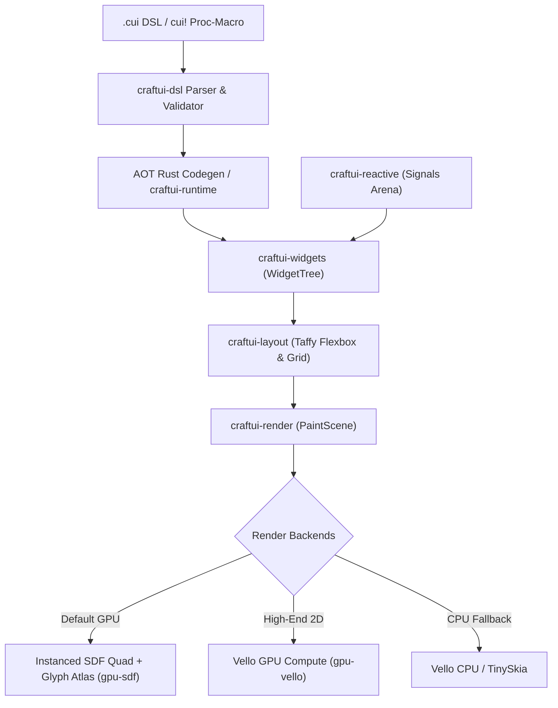

# Introduction to CraftUI

**CraftUI** is a cross-platform GUI framework written in Rust. It is at an early stage: version 0.1.0, with an API that will change.

CraftUI aims to provide:
1. **GPU rendering with a CPU fallback:** 2D vector and text rendering through WGPU (Vulkan, DirectX 12, Metal, WebGPU), with software rasterizers for machines without a usable GPU.
2. **One codebase for desktop, Android and the Web:** all three can be built from a Linux machine. iOS support exists in the source tree but is not built or tested in CI.
3. **A declarative UI language (`.cui`):** concise markup with fine-grained reactivity, two-way bindings and animations, compiled to Rust at build time.
4. **One manifest for packaging:** `craftui.toml` holds the app id, version and permissions, and the CLI generates the Android project from it.

What is verified today, and how, is listed in the repository README. Binary
sizes measured in CI for the notes example are about 6.2 MB for the WebAssembly
module and 8.9 MB for the Android `arm64-v8a` library, both before compression.

---

## How the parts fit together

- **No tree diffing.** A changed `Signal` updates only the widgets and layout
  nodes that read it.
- **Frames on demand.** The event loop waits when nothing changes; timers,
  animations and the text caret wake it. Idle power use has not been measured.
- **Accessibility.** The widget tree is exported through AccessKit on desktop
  and as ARIA elements on the Web. Testing with real screen readers has not
  been done.
