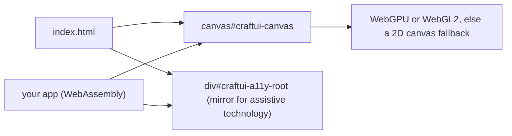

# Web (WebAssembly)

A CraftUI app compiles to WebAssembly and draws into a `<canvas>`. The result is
a folder of static files that any web server can host.

## How it works in the browser



- **Rendering.** The runner asks the browser for a GPU surface (WebGPU, or
  WebGL2) when the page loads. This is asynchronous, so the first frame is drawn
  when the surface is ready. If the browser offers neither, the runner paints
  with a CPU renderer through the 2D canvas API instead. CI tests the app in
  headless Chrome with software graphics; it does not record which of the two
  paths was taken.
- **Accessibility.** After each paint the widget tree is mirrored into
  `#craftui-a11y-root` as real DOM elements with `role`, `aria-label` and state
  attributes, positioned over the widgets they describe. Screen readers and
  automated tests use this layer.
- **Text entry.** A hidden `<input>` receives keyboard, IME and paste events
  while a text field has focus, which is what makes mobile keyboards work.
- **Window size.** The app follows the size of the page; `Window.width` and the
  breakpoints in `.cui` are in CSS pixels.

## Build

```bash
rustup target add wasm32-unknown-unknown
cargo install wasm-bindgen-cli --version <the wasm-bindgen version in Cargo.lock>

craftui build --platform web --release -p <package> -o dist/web
```

The output folder contains:

| File | Purpose |
|---|---|
| `index.html` | The host page, generated by the CLI. It is overwritten on every build. |
| `craftui_app.js` | JavaScript glue generated by `wasm-bindgen`. |
| `craftui_app_bg.wasm` | The app. |

The `wasm-bindgen-cli` version must match the `wasm-bindgen` crate exactly, or
the build stops with a version error.

## The entry point

The package needs a `cdylib` library with a start function:

```rust
#[cfg(target_arch = "wasm32")]
#[wasm_bindgen::prelude::wasm_bindgen(start)]
pub fn start() -> Result<(), wasm_bindgen::JsValue> {
    craftui_platform_web::start_web_app(
        craftui_platform_web::WebBridgeConfig::default(),
        |cx, tree, _textures, _dispatcher| build_my_ui(cx, tree),
    )
}
```

`WebBridgeConfig` sets the canvas id (`craftui-canvas` by default), whether the
URL hash follows navigation, and can force the 2D fallback.

## Run locally

```bash
craftui run --platform web -p craftui-example-notes   # builds, then serves on http://localhost:8080
```

Name your own app after `-p`. Without a package the CLI builds the default
`craftui-platform-web` package, which has no `cdylib`, so the generated page has
no application bundle to load.

Or serve an existing build with any static server. The server must send
`.wasm` files as `application/wasm`.

## Size

Measured in CI for `examples/notes` (release profile, `opt-level = "z"`, LTO,
stripped): `craftui_app_bg.wasm` is about 6.2 MB before compression. Most of it
is the two renderers and the text stack. Serve it with gzip or Brotli enabled;
no smaller figure has been measured for this repository, so treat any you see
elsewhere as a goal rather than a result.

## Testing a web build

`.github/scripts/web-smoke.mjs` drives a built bundle in headless Chrome with no
npm dependencies: it finds widgets through the accessibility layer, clicks and
types, reloads, and checks `localStorage`. Use it as a template:

```bash
node .github/scripts/web-smoke.mjs dist/web /tmp/smoke-output
```

The script's checks are written for the Notes app: it looks for the welcome-note
text, the Notes widget labels and the `craftui-notes/v1` storage key. Run it on a
Notes build, or replace those checks with your own app's before using it.
